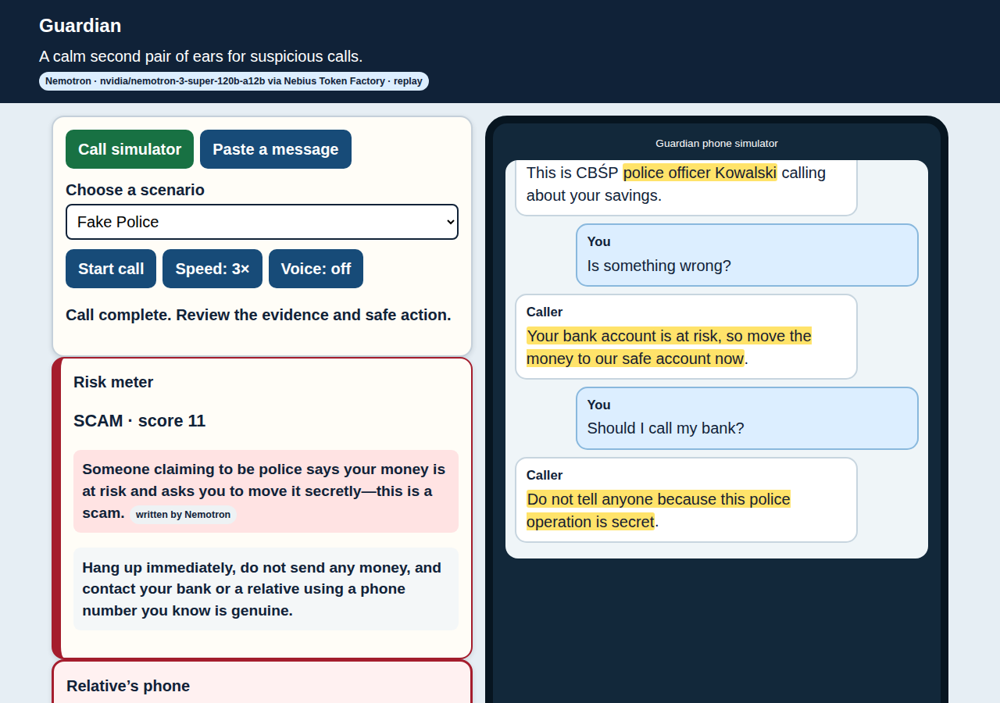
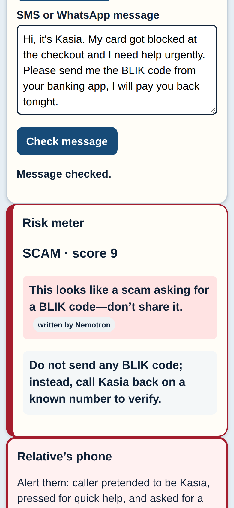

# Guardian

**A calm second pair of ears for suspicious calls.** Guardian listens to a phone call (or
reads an SMS) on behalf of an elderly person, recognises a scam script as it unfolds, warns
them in plain words, alerts a relative, and says exactly what to do next.

Entry for the NVIDIA × Nebius Global AI Hackathon (2026), track *Best Apps and Agents*.
Built on **NVIDIA Nemotron** (`nvidia/nemotron-3-super-120b-a12b`) served by **Nebius Token
Factory**, with **Tavily** search over official police, bank and CERT pages.



*A fake "CBŚP police officer" call. Guardian quotes the caller's own words, links official
warnings, and tells the relative what happened.*



*The same app on a phone (390px): a "friend" asks for a BLIK code by SMS.*

## Why

Phone scams hit older people hardest: the "grandson in an accident" call, the fake police
officer who wants your savings moved to a "safe account", the "bank security department"
asking you to install AnyDesk, the BLIK code a "friend" urgently needs. All of these follow
known scripts that police publish warnings about. Guardian recognises the script during the
call, while there is still time to hang up.

## How it works

Every new caller turn runs through a five-step pipeline:

1. **Signal extraction (Nemotron).** The transcript goes to Nemotron, which returns scam
   tactics from a closed list (`impersonation_authority`, `safe_account`, `blik_code_request`,
   `remote_access_install`, …), each with a verbatim quote.
2. **Quote validator (code).** A tactic survives only if its quote really occurs in what the
   *caller* said. Hallucinated evidence is dropped.
3. **Claim check (Tavily).** For each tactic Guardian searches official domains only
   (`policja.pl`, `cert.pl`, `knf.gov.pl`, `zbp.pl`, `gov.pl`, `europol.europa.eu`, …) for
   a page describing the same scheme.
4. **Risk scorer (code, no LLM).** It scores the validated tactics as `SAFE`, `CAUTION` or
   `SCAM`.
5. **Advisor (Nemotron).** It writes a short warning for the elder, an alert for the
   relative, and one safe action. If the model is unreachable, a fixed template is used:
   the warning never depends on the network.

**No evidence, no alarm.** The `Verdict` model refuses to say `SCAM` without at least two
distinct validated tactics with quotes **and** at least one official source. A guardian that
cries wolf is useless, so benign calls (the real grandson, a real bank appointment reminder)
are part of the test set.

More detail: [`docs/ARCHITECTURE.md`](docs/ARCHITECTURE.md).

## Results on the bundled scenarios

| Scenario | Expected | Guardian | Turn of CAUTION → SCAM |
|---|---|---|---|
| `grandson_accident`: "grandson" in an accident, courier for cash | scam | **SCAM** | 2 → 6 |
| `fake_police`: fake CBŚP officer, "safe account", secrecy | scam | **SCAM** | 2 → 4 |
| `fake_bank_anydesk`: "bank security" asks to install AnyDesk | scam | **SCAM** | 2 → 4 |
| `blik_friend`: a "friend" asks for a BLIK code | scam | **SCAM** | 4 → 4 |
| `real_grandson`: the real grandson about Sunday dinner | safe | SAFE | 2 → never |
| `real_bank_reminder`: a real bank appointment reminder | safe | SAFE | never |

Turns are counted from 1 across both speakers (the elder usually opens the call). `python -m guardian.demo --offline` prints: `scams detected: 4/4, false alarms: 0/2`.
These numbers come from real Nemotron and Tavily responses recorded on 15.10.2026. Every
warning and every source in the replay is real model and search output, not hand-written.
The real grandson's "Hi Grandma, it is your grandson Adam" briefly raises CAUTION. It drops back to SAFE as soon as
the call turns out to be ordinary, because one tactic without an official source can never
reach SCAM.
The *Paste a message* tab has four SMS examples (BLIK from a friend, fake InPost fee, fake
bank block, a real parcel notice). The first three are flagged as scams; the real one is not.

**Your own text, offline.** Without keys there is no recorded Nemotron answer for text you
type yourself, so Guardian falls back to a deterministic English/Polish rule-based detector.
Its quotes still go through the same validator, the sources are the recorded Tavily results
for the matched tactics, and the SCAM gate is unchanged. The UI labels this evidence
*offline rules (no AI model)*. The same fallback catches a Nemotron outage in live mode.

**Listen live.** The *Listen live* tab transcribes speech in the browser (Web Speech API,
Chrome and Edge, English or Polish) and sends every phrase into the same pipeline. A
*Caller / Me* toggle marks who is speaking, and a text box lets you type lines when there is
no microphone. When the verdict first reaches SCAM, Guardian reads the warning and the safe
action aloud.

## Run it

You need Python 3.12 or newer. Run everything from the repository root: scenarios,
messages and fixtures are read from the checkout.

```bash
python3 -m venv .venv
.venv/bin/pip install -e '.[dev]'
.venv/bin/pytest -q                          # test suite, fully offline
.venv/bin/python -m guardian.demo --offline  # CLI run of all six scenarios
.venv/bin/uvicorn guardian.app:app           # web demo at http://127.0.0.1:8000
```

### Offline replay vs live

By default (`LIVE=0`) Guardian needs no keys and no network: model and search responses
are replayed from `fixtures/`. The bundled fixtures are real Nemotron and Tavily responses
recorded live. The UI says so honestly: the badge shows `replay`, and anything written by
hand rather than by Nemotron or Tavily would be labelled `seeded`.

For CLI live calls (the hosted web UI also needs `JUDGE_CODE`, described below), put these values in `~/.config/hackathon/secrets.env`
(template: [`.env.example`](.env.example)) or export them in your shell:

```bash
LIVE=1
NEBIUS_API_KEY=...        # Nebius Token Factory
NEMOTRON_MODEL=nvidia/nemotron-3-super-120b-a12b
TAVILY_API_KEY=...
```

`scripts/record_fixtures.py` runs all six call scenarios and four SMS examples live, and
stores the responses as reviewed replay fixtures (`--scenario <id>` or `--message <id>`
records just one). Each Tavily query is sent at most once per run, and live search
responses already in `fixtures/` are reused (delete a file to refresh it), so a full
re-recording costs Tavily credits only for new queries. Keys are read from the environment
only and never printed or logged.

### Family alert on Telegram

On the first SCAM verdict of a call (and on every SCAM message check) Guardian can send the
relative alert, the tactics and their quotes to a family member's Telegram chat. It is off
unless both values are set (environment or `secrets.env`):

```bash
TELEGRAM_BOT_TOKEN=...    # from @BotFather
TELEGRAM_CHAT_ID=...      # press Start in the bot, then: python scripts/telegram_chat_id.py --write
```

The message is plain text (no markup), at most five alerts go out per ten minutes, and the
UI shows whether the alert was sent. Tests never reach Telegram.

Checked end to end with a real bot: the `fake_police` call and a BLIK message from "a friend"
both reached the family member's phone in Telegram (18–19.10.2026).

## Layout

```
guardian/        pipeline, models, Nemotron and Tavily clients, scorer, advisor, FastAPI app
guardian/static/ the single-page phone simulator
scenarios/       six synthetic calls (no real people or numbers)
messages/        four SMS examples
fixtures/        replay responses
scripts/         record_fixtures.py (live), seed_fixtures.py (offline seed), telegram_chat_id.py
tests/           pytest suite
```

## Why there is no real phone line

Ordinary apps cannot hear a GSM call: Android has blocked call audio for third-party apps
since Android 10, and iOS never exposed it. A real line is possible through a paid VoIP
bridge (Twilio or Telnyx media streams), but judges should be able to try Guardian for
free. So the demo is a call simulator in the browser that speaks the caller's lines aloud.
The call source is a pluggable adapter: a telephony adapter can be added later without
touching the pipeline.

### Hosted live demo (judges)

Replay samples are open to everyone. Live analysis of your own text or microphone
transcript needs the code in the Devpost testing instructions. Use **Live mode →
Unlock**; the HttpOnly session lasts 30 days and survives container restarts.
Without unlocking, the offline rules detector and recorded examples remain available.
The Vercel demo stays replay-only.

Server environment variables (names only): `LIVE`, `JUDGE_CODE`, `NEBIUS_API_KEY`,
`TAVILY_API_KEY`, `NEMOTRON_MODEL`, `LIVE_DAILY_CAP`, `DATA_DIR`, `PORT`,
`TELEGRAM_BOT_TOKEN`, `TELEGRAM_CHAT_ID`.

Build with `docker build -t guardian .` and run one long-lived container with a
persistent disk mounted at `/data`, writable by UID 10001. Pass the variables
through the hosting platform's environment settings. The container runs
`guardian.app:app`; its default port is 8000. Keep it available through 2026-12-15.
The daily limit defaults to 300 UTC-day live checks across all judges; each own
message or caller transcript turn consumes one check (including failed provider
calls). Once exhausted, choose a replay sample. A lost live call session must be
started again; replay sessions can still rebuild from history.


## License

[MIT](LICENSE)
